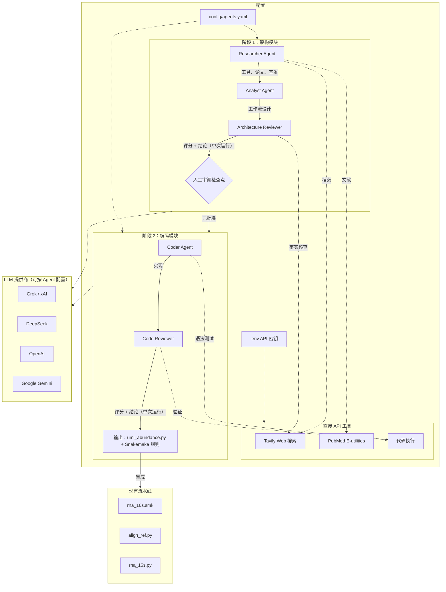

## UMI 16S rRNA 架构师

从零开始构建 16S rRNA 项目，我创建了这个多代理工具来收集领域知识并进行项目架构设计。包含 2 个模块：
1. multi_agent_architect：通用多代理 LLM 规划器，用于自动化工作流架构设计、审阅和代码生成。
2. rna_16s：实际的生物信息学流水线（Snakemake 工作流 + Python 脚本）。最终的 per-UMI 设计没有采用 Agent 的产出，原因见 [Agent 哪里出了错](#agent-哪里出了错)。

## Step1. 多代理架构

我之前没有 16S rRNA 数据分析的经验，所以第一步是收集领域知识并设计工作流。本模块是一个采用 CrewAI 编排和直接 API 工具集成的多代理 LLM 系统，实现自动化工作流设计和代码生成。

**关键词：** 多代理系统、CrewAI、Grok、PubMed、Tavily

### 架构



系统分为两个阶段，中间设有人工审阅检查点：

**阶段 1 -- 架构模块**（Researcher -> Analyst -> Reviewer）
1. **Researcher Agent** 通过 Tavily 和 PubMed 搜索 UMI 16S 聚类的最新工具和论文。
2. **Analyst Agent** 基于搜索结果设计逐步的生物信息学工作流。
3. **Architecture Reviewer** 对设计打分（0-10）并给出 PASS/REVISE 结论。每个 crew 只运行一次（`Process.sequential`），REVISE 不会让 Analyst 重新运行。

**人工审阅检查点** -- 用户审阅通过的架构方案后再进入下一阶段。

**阶段 2 -- 编码模块**（Coder -> code-Reviewer）
4. **Coder Agent** 将已批准的工作流实现为 Python 代码，与现有 `rna_16s.smk` 集成。
5. **Code Reviewer** 验证语法、逻辑、边界情况和集成兼容性，并给出修改指令。和阶段 1 一样，不会自动重跑。

每个 Agent 的 LLM 提供商可通过 `config/agents.yaml` 独立配置（Grok、DeepSeek、OpenAI、Gemini）。

---

### 结果

#### 阶段 1：架构设计

```bash
cd multi_agent_architect/src
python main.py --phase architecture \
    --task "UMI-based 16S rRNA clustering for metatranscriptomic abundance"
```

- **输入：** 任务描述（自然语言）
- **输出：** `outputs/architecture_YYYYMMDD_HHMMSS.md` -- 结构化的工作流设计，包含工具推荐、逐步 I/O 规范和集成方案。

#### 阶段 2：代码生成

```bash
cd multi_agent_architect/src
python main.py --phase coding \
    --architecture outputs/architecture_YYYYMMDD_HHMMSS.json
```

- **输入：** 已批准的架构文档
- **输出：** `outputs/coding_YYYYMMDD_HHMMSS.md` -- 实现代码（umi_abundance.py、Snakemake 规则、依赖清单）

#### 完整流水线（含交互式暂停）

```bash
cd multi_agent_architect/src
python main.py --phase all
```

运行阶段 1，暂停等待人工审阅，然后进入阶段 2。

---

### 材料与方法

#### 数据背景

| 组件 | 描述 |
|------|------|
| 输入数据 | UMI 标记的 NGS reads（FASTQ），16S rRNA 扩增子 |
| 现有流水线 | `rna_16s.smk` -- Snakemake 工作流，支持 meta denovo、参考比对、片段 denovo |
| 参考序列 | ZymoBIOMICS 16S 标准菌群（8 种细菌） |
| 丰度基准 | Zymo 理论组成，用于基准测试 |

#### 工具与算法

| 组件 | 工具 | 选择理由 |
|------|------|----------|
| Agent 编排 | [CrewAI](https://github.com/crewai/crewai) | 基于角色的 Agent 定义，内置 delegation、反思循环和情景记忆。最适合结构化顺序任务的迭代质量控制 |
| Web 搜索 | [Tavily](https://tavily.com/) | AI 综合的网络搜索，带来源归属。直接 API 调用（不经过 CrewAI）以确保可靠性 |
| 文献搜索 | [PubMed E-utilities](https://www.ncbi.nlm.nih.gov/books/NBK25500/) | 直接 XML API 访问 NCBI，结构化的文章元数据（PMID、摘要、作者） |
| 默认 LLM | [Grok](https://x.ai/)（xAI） | 强推理能力，网络事实根基，OpenAI 兼容 API。可按 Agent 配置 |

#### 多代理架构

混合架构将 CrewAI 用于 Agent 生命周期管理，直接 HTTP API 调用用于工具集成：

- **CrewAI 层** -- Agent 角色/目标/背景定义、任务排序、记忆持久化、delegation 控制。
- **直接 API 层** -- Tavily 和 PubMed 搜索函数绕过 CrewAI 内置工具系统，对请求格式、错误处理和响应解析有更多控制。
- **LLM 抽象** -- `config.py` 提供统一的 `call_llm()` 函数，根据每个 Agent 的配置分发到正确的提供商。生成和审阅使用不同 LLM 可能减少共享盲点，但有记录的那次运行所有 Agent 都用的是 GPT-4o。

#### 防降智策略

| 策略 | 实现方式 |
|------|----------|
| 情景记忆 | CrewAI 内置的跨任务记忆 |
| Reviewer 反思循环 | **未实现。** `agents.yaml` 里有 `max_iterations` 和 `quality_threshold`，但代码没有读取它们；每个 crew 只运行一次 |
| 可配置 LLM 多样性 | 不同 Agent 可使用不同 LLM 提供商，降低共享故障模式 |
| 结构化输出格式 | Task 指定 `expected_output` 约束 Agent 响应 |
| 状态总结 | Reviewer 产出结构化评分和具体反馈 |

---

### 安装

1. 安装依赖：
   ```bash
   pip install -r multi_agent_architect/requirements.txt
   ```

2. 配置 API 密钥 -- 复制 `.env.example` 为 `.env`：
   ```
   GROK_API_KEY=xai-your-key
   TAVILY_API_KEY=tvly-your-key
   PUBMED_EMAIL=your.email@example.com
   ```

3. （可选）在 `config/agents.yaml` 中自定义各 Agent 的 LLM。

---

### 项目结构

```
agentic_bioArchitecturer/
├── multi_agent_architect/           # 模块 1：多代理 LLM 系统
│   ├── config/
│   │   └── agents.yaml             # Agent 角色、LLM 配置、工具设置
│   ├── src/
│   │   ├── main.py                 # 入口（--phase architecture|coding|all）
│   │   ├── config.py               # API 密钥管理、LLM 分发
│   │   ├── tools/
│   │   │   ├── tavily_search.py    # Tavily 网络搜索（直接 API）
│   │   │   └── pubmed_search.py    # PubMed E-utilities（直接 API）
│   │   └── crews/
│   │       ├── architecture_crew.py # 阶段 1：Researcher + Analyst + Reviewer
│   │       └── coding_crew.py       # 阶段 2：Coder + code-Reviewer
│   ├── outputs/                     # 生成的架构文档和代码
│   ├── requirements.txt
│   └── .env.example
├── rna_16s/                         # 模块 2：16S rRNA Snakemake 流水线
│   ├── rna_16s.smk                  # Snakemake 工作流（4 种方法）
│   ├── perUMI_denovo.smk            # 方法 4：逐 UMI MEGAHIT 组装（由 rna_16s.smk include）
│   ├── rna_16s.py                   # 核心分析函数
│   ├── align_ref.py                 # 参考比对与丰度计算
│   ├── bc2fq.py                     # 条码转 FASTQ 提取
│   ├── get_max_fa.py                # 选取每个条码/UMI 的最长 contig
│   ├── group_reads_by_umi.py        # 按 BX:Z: UMI 标签分组 PE reads
│   ├── per_umi_megahit_consensus.py # 并行 MEGAHIT 逐 UMI De Novo 组装
│   ├── consensus_per_umi.py         # 组装后 contig 质控与长度过滤
│   └── config.yaml                  # 流水线配置（样本、参数、模块）
├── outputs/                         # 最终结果（图表）
├── docs/
│   ├── 16s_Workflow.md              # 详细工作流笔记
│   ├── plan.md                      # 开发计划与决策
│   └── flowchart.mmd               # Mermaid 架构图
├── README.md
└── README_CN.md
```

---

### 讨论

#### 为什么选择多代理而非单代理

单次 LLM 调用无法可靠地完成文献搜索、工作流设计、代码生成和质量审阅的完整循环。每个子任务需要不同的专业知识、工具访问和评估标准。多代理方案：

- **关注点分离** -- Researcher 专注搜索质量，Analyst 专注设计连贯性，Reviewer 专注科学严谨性。
- **审阅显式化** -- Reviewer 的评分和结论写入文件。当前版本不会据此触发修订，所以初始错误仍可能漏过去（见下文）。
- **人在回路中** -- 阶段 1 和阶段 2 之间的检查点防止在有缺陷的架构上浪费算力。

#### 为什么选择 CrewAI 而非 Swarm

| 维度 | CrewAI | OpenAI Swarm |
|------|--------|--------------|
| **任务结构** | 基于角色的顺序/层级执行 | 动态 handoff，去中心化 |
| **反思机制** | 内置任务串联；审阅-修订循环仍需自己写（本项目未实现） | 需手动实现 |
| **记忆** | 内置情景记忆 | 无内置记忆 |
| **LLM 灵活性** | 任意提供商（Grok、DeepSeek、OpenAI、Gemini） | 仅 OpenAI |
| **最佳场景** | 结构化的研究-设计-编码-审阅链 | 探索性、并行微代理 |
| **生产就绪度** | 成熟（GitHub 45k+ stars，2026） | 实验性 |

本项目的工作流本质上是顺序的、角色结构化的（研究 -> 设计 -> 审阅 -> 编码 -> 审阅）。CrewAI 的基于角色的 Agent 模型是天然的契合。Swarm 的去中心化 handoff 模型更适合开放式探索或并行数据库查询 -- 这是 Researcher Agent 未来可能的扩展方向。

#### Agent 哪里出了错

唯一一次有记录的阶段 1 运行（`outputs/architecture_20260313_174532.md`，60 秒，所有 Agent 都用 GPT-4o）给出的设计被 Reviewer 打了 8.25/10 并判为通过。这个设计放到真实数据上不成立，最终的 per-UMI 流水线没有采用它：

| Agent 的设计 | 问题 | 最终设计 |
|--------------|------|----------|
| 每条 read 开头 8bp UMI | 凭空假设，Agent 从未拿到数据规格 | `BX:Z:` tag 中的 15bp UMI |
| 先用 UMI-tools 去重，再对去重后的 reads 聚类 | 去重会把每个 UMI 压成一条 read，重建分子需要的 reads 被丢掉了 | 按 UMI 分组并保留全部 reads，逐 UMI 组装（MEGAHIT） |
| QIIME2 / DADA2 ASV 降噪 | 针对短扩增子 reads，不适合从 ~10x 覆盖重建 ~1500bp 分子 | 逐 UMI de novo 组装，保留 ≥1400bp 的 contig |
| 用 quantile normalization 算丰度 | 丰度是组成型数据，quantile normalization 会把样本强行拉成同一分布 | 用 ZymoBIOMICS 理论组成做验证 |

原因：
- Researcher 只看到截断到 200 字符的搜索摘要，Analyst 只收到一句任务描述。没有 Agent 读过现有代码或数据规格。
- Reviewer 和 Analyst 用的是同一个模型，审阅时对照的是通用 best practice，不是数据本身，所以放过了假设错误的设计。

结论：做架构时缺的是约束信息，不是更多 Agent 角色。看不到数据的 Reviewer 发现不了与数据不符的设计。

#### 待办事项

- [ ] 使用真实 UMI 16S FASTQ 数据端到端测试
- [ ] 将生成的流水线与手动 DADA2+UMI-tools 工作流进行基准测试
- [ ] 添加 RAG 层（FAISS），跨运行持久化文献上下文
- [ ] 迁移至 LangGraph，实现跨会话的有状态检查点
- [ ] 并行 Researcher 子代理（Swarm 风格），用于多数据库搜索

---

## Step2. 16S rRNA 工作流

利用 Step1 的架构设计和额外 LLM 搜索获取的领域知识，构建了这个 16S rRNA 宏转录组多样性测序分析项目，支持三种分析方法。

### 背景

16S rRNA 扩增子测序是微生物群落分析的标准方法。结合 UMI（唯一分子标识符）可以校正 PCR 扩增偏差，提高聚类准确性和丰度估计精度。这在宏转录组学中尤为重要，因为转录本水平的定量能捕捉活跃的微生物群体。

传统工具（DADA2、Mothur、QIIME2）可以处理聚类和分类注释，但将 UMI 去重整合到工作流中需要专用工具（UMI-tools、UMI-nea）和精细的参数调优。本项目使用多代理 LLM 系统自动化完成这一流水线的研究、设计和实现。

分析工作流（`rna_16s.smk`）支持四种方法：meta denovo 组装、参考序列比对、片段 denovo 组装，以及面向 PE150 全长 16S 的 Per-UMI De Novo 组装。

**关键词：** UMI、16S rRNA、宏转录组学、微生物丰度

---

### 结果与影响


该流水线通过四种互补方法实现微生物群落分析：

1. **Meta De Novo** -- 使用 MetaSPAdes 进行宏基因组组装，通过 Kraken 进行物种注释
2. **Align to Ref** -- 将测序 reads 比对到 ZymoBIOMICS 16S 标准菌群进行物种鉴定
3. **Frag De Novo** -- 利用 stLFR 共条码（BX tag）进行基于 Fragment 的组装，按条码分组 reads → 逐条码 SPAdes 组装 → 选取最长 contig
4. **Per-UMI De Novo**（新增）-- PE150 全长 16S 单分子重建。每个 UMI（BX tag，15bp）代表一个 16S 分子，MEGAHIT 对 ~50 reads/UMI（~10x 深度）进行 de novo 组装，无需参考比对，输出全长（~1500bp）consensus 序列

Per-UMI De Novo 方法在单分子水平上校正 PCR 扩增偏差：
- MEGAHIT 优于 SPAdes：启动开销低，在扩增子数据 ~10x 覆盖度下更稳定，不过度纠错
- 并行组装：`ThreadPoolExecutor` 多 UMI 组并行运行
- 长度过滤：< 1400bp 的 contig 丢弃（不完整 16S）

### 材料与方法

#### 输入与输出

| 组件 | 描述 |
|------|------|
| 输入（meta/align/frag） | 上游步骤的 BAM 文件 `Align/{SAMPLE_ID}.sort.bam` |
| 输入（per_umi_denovo） | PE150 FASTQ `data/split_read.{1,2}.fq.gz`，含 BX:Z: 标签（15bp UMI） |
| UMI/条码来源 | FASTQ header 中的 BX:Z: 标签（所有方法使用同一字段） |
| 输出（常规） | QUAST 组装质量报告 |
| 输出（ZymoBIOMICS） | 丰度统计，比较观测值与理论组成 |

#### 分析工作流

**方法 1: Meta De Novo**
```
FASTQ → Kraken（分类）→ MetaSPAdes（组装）→ QUAST（评估）
```

**方法 2: Align to Ref**
```
FASTQ → BWA mem → SAMtools sort → idxstats → 丰度计算
参考序列：ZymoBIOMICS 16S 标准菌群（8 种细菌，ZymoBIOMICS.STD.refseq.v2.16s.fasta）
```

**方法 3: Frag De Novo**
```
BAM → 按 BX:Z:barcode 分组 → 筛选 200-1000 reads/barcode →
bc2fq.py（提取 FASTQ）→ SPAdes（逐条码组装）→
合并 contigs → QUAST + 覆盖度分析
```

**方法 4: Per-UMI De Novo**（全长 16S，PE150）
```
FASTQ（含 BX:Z: 标签）→ fastp 剪切 →
group_reads_by_umi.py（15bp UMI → 逐 UMI FASTQ，≥5 reads）→
per_umi_megahit_consensus.py（MEGAHIT 并行组装）→
过滤 ≥1400bp → 合并 → QUAST + Zymo 丰度比较
```

#### 关键函数 (rna_16s.py)

| 函数 | 用途 |
|------|------|
| `pct_denovoFrag_ref()` | 计算片段覆盖度与 16S 参考长度的比值 |
| `coverage_bias()` | 可视化片段在 16S 参考上的覆盖分布 |
| `per_base_density()` | 生成逐碱基覆盖密度图 |
| `merge_exon_ref()` | 将多个 contigs 合并为单条序列 |

#### 工具与算法

| 组件 | 工具 | 选择理由 |
|------|------|----------|
| 组装器（meta/frag） | [SPAdes](https://github.com/ablab/spades) | 多功能组装器，支持多种模式（meta、rna、plasmid） |
| 组装器（per-UMI） | [MEGAHIT](https://github.com/voutcn/megahit) | Succinct De Bruijn Graph，内存低、速度快，~10x 扩增子数据表现优于 SPAdes --isolate |
| Reads 剪切 | [fastp](https://github.com/OpenGene/fastp) | 快速 PE 接头剪切 |
| 比对 | [BWA](http://bio-bwa.sourceforge.net/) | 快速短 reads 比对工具 |
| 分类 | [Kraken](https://ccb.jhu.edu/software/kraken/) | 基于 k-mer 的分类方法 |
| 组装质控 | [QUAST](https://quast.sourceforge.net/) | 全面的组装质量指标 |
| 参考 | ZymoBIOMICS 16S | 标准 mock 菌群（8 种），组成已知 |
| 聚类（下游） | [DADA2](https://benjjneb.github.io/dada2/) | ASV 级分辨率，16S 领域充分基准测试 |

#### Frag De Novo 算法

1. **条码分组** -- 从 BAM 中按 BX:Z: barcode 提取 reads
2. **质量筛选** -- 选择 200-1000 reads/barcode 的条码（避免低覆盖或 PCR 重复）
3. **逐条码组装** -- 对每个条码的 reads 运行 SPAdes
4. **Contig 选取** -- 保留每个条码的最长 contig（contigs_max.fasta）
5. **参考比对** -- 通过 minimap2 将 contigs 比对到 ZymoBIOMICS 16S 参考
6. **覆盖度计算** -- 对每个片段计算：`frag_length / ref_16S_length`
7. **丰度估计** -- 将观测覆盖度与理论 Zymo 组成进行比较

### 讨论

**优势：**
- 片段级别组装保留了标准 16S 扩增子测序中丢失的长程信息
- 逐条码组装实现复杂群落的株级别分析
- ZymoBIOMICS 集成提供基准测试的真值

**局限：**
- Frag De Novo 需要带 BX tag 条码的 stLFR 数据
- Per-UMI De Novo 要求 ≥5 reads/UMI 和 ~10x 深度；reads 不足的 UMI 组会被过滤
- 全长 16S + PE150：reads 无法 merge，必须 assembly（不能直接 majority-vote）

**待办：**
- [x] Per-UMI De Novo 组装（MEGAHIT，方法 4）
- [ ] 使用真实 UMI 16S FASTQ 数据端到端测试
- [ ] 对 per-UMI contigs 进行 ZymoBIOMICS 基准测试
- [ ] Per-UMI consensus 下游 DADA2/vsearch 聚类
- [ ] 添加 RAG 层（FAISS），跨运行持久化文献上下文

---

### 参考文献

1. [CrewAI](https://github.com/crewai/crewai) -- 多代理编排框架
2. [UMI-tools](https://github.com/CGATOxford/UMI-tools) -- UMI 提取和去重
3. [DADA2](https://benjjneb.github.io/dada2/) -- 高分辨率扩增子去噪
4. [QIIME2](https://qiime2.org/) -- 微生物组生物信息学平台
5. [Tavily](https://tavily.com/) -- AI 综合的网络搜索 API
6. [PubMed E-utilities](https://www.ncbi.nlm.nih.gov/books/NBK25500/) -- NCBI 文献 API
7. [Grok](https://x.ai/) -- xAI 大语言模型
8. [ZymoBIOMICS](https://www.zymoresearch.com/collections/zymobiomics-microbial-community-standards) -- 微生物群落标准品
9. [mclUMI](https://doi.org/10.1093/bioinformatics/btaf068) -- 基于 Markov 聚类的 UMI 去重（2025）
10. [SPAdes](https://github.com/ablab/spades) -- De novo 基因组组装器
